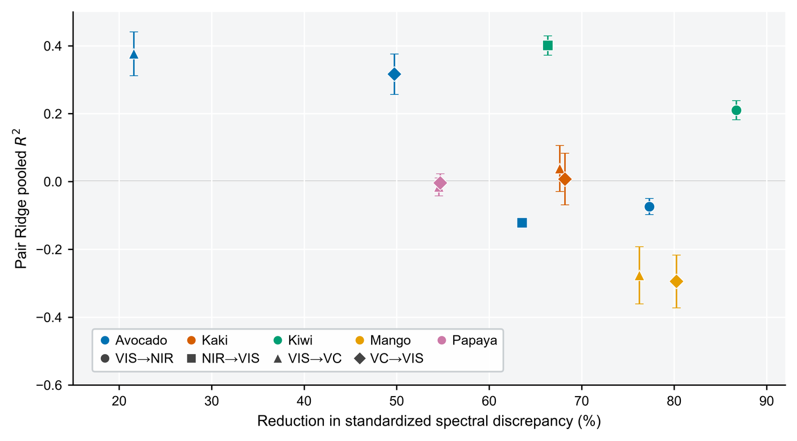
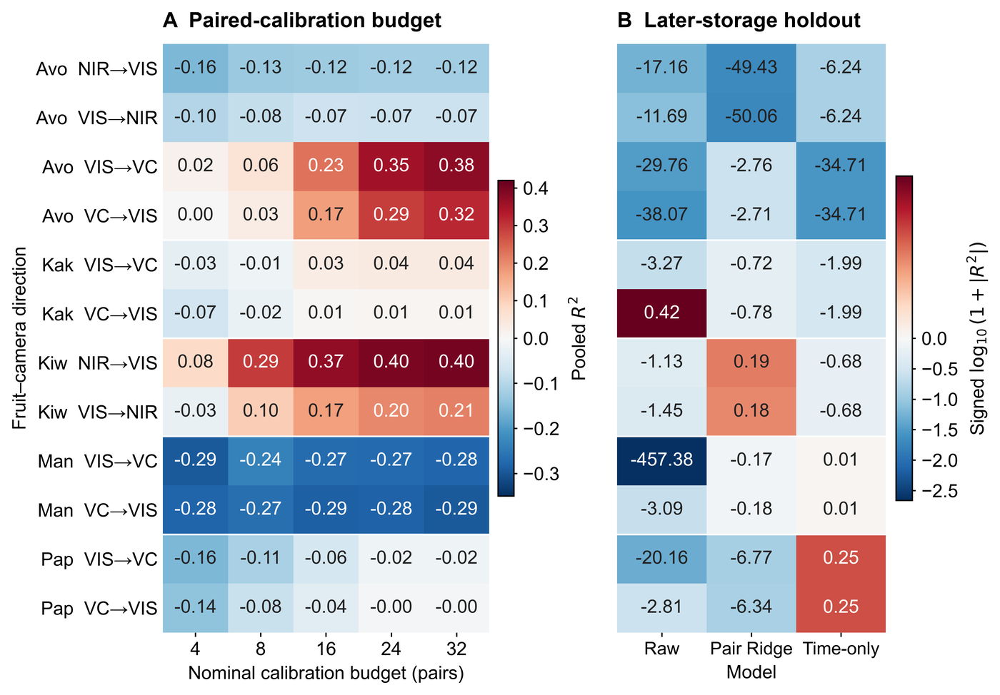
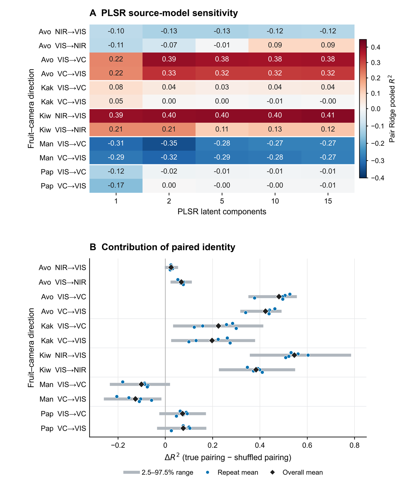

# 跨相机果实硬度预测的光谱校准效果评估

**Evaluation of spectral calibration for cross-camera fruit firmness prediction**

本项目基于 **DeepHS-Fruit v2** 公开高光谱数据集，研究更换相机后果实硬度预测模型的复用效果。通过果实身份分组验证、配对关系对照、校准样本量实验和贮藏后期留出测试，评估光谱校准在不同水果、相机组合及贮藏阶段下的表现。

仓库提供实验代码、固定版本结果 CSV、结果图、绘图脚本和运行说明。

## 研究方法

评估流程以 **Elastic Net** 建立源相机硬度预测模型，以 **Pair Ridge** 作为配对光谱校准方法：利用训练果实的源—目标配对光谱拟合目标到源相机的岭回归映射，再将校准后的目标光谱输入源模型。

主要实验包括：

- **跨相机性能比较**：比较 Raw、Scale、CORAL、Pair Ridge、PDS(w=1) 和 PDS(w=2)。
- **配对身份分析**：通过打乱配对关系考察同一果实跨相机对应关系的作用。
- **光谱与任务联合评价**：同时分析光谱差异变化与硬度预测的 R²、RMSE 和 MAE。
- **校准预算与时间测试**：考察配对样本量及贮藏阶段变化对模型传递的影响。
- **敏感性分析**：考察源模型、正则化和特征维度设置的影响。

## 实验设置与主要结果

| 项目 | 设置 |
| --- | --- |
| 数据集 | DeepHS-Fruit v2 |
| 水果 | 鳄梨、柿、猕猴桃、芒果、番木瓜 |
| 相机代码 | VIS、VIS_COR、NIR |
| 配对子集与方向 | 6 个水果—相机配对子集，12 个有向传递方向 |
| 主验证方案 | 按物理果实身份分组，5 次重复、每次 5 折 |
| 源模型 | Elastic Net；PLSR 用于敏感性分析 |
| 共同光谱表示 | 20 个波长位置上的果实平均光谱 |
| 评价指标 | 原始硬度尺度上的 R²、RMSE、MAE |

每次重复先合并各测试折预测，再计算指标；结果以五次重复的均值和标准差汇总。固定版本主表中，Pair Ridge 的表现如下：

| 比较指标 | 方向数 |
| --- | ---: |
| 平均 R² 高于 Raw 直接传递 | 10 / 12 |
| 平均 R² 为正 | 6 / 12 |
| 平均 R² 在六种设置中最高 | 4 / 12 |

实验显示，光谱校准的效果随水果、相机组合和贮藏阶段而变化。光谱差异与硬度预测性能需联合评价，以判断模型在目标相机上的复用效果。

## 项目结构

```text
cross-camera-fruit-firmness/
├── physfruit/                  # 实验、光谱处理与果实分组代码
├── baseline_cache/             # 61 个固定版本结果 CSV
├── JFE_submission/figures/      # 三组数据图的生成脚本
├── tools/
│   └── check_frozen_results.py  # 结果完整性与主表汇总核验
├── docs/
│   ├── reproduction.md         # 数据准备、实验命令与统计口径
│   ├── paper_scope.md          # 论文实验入口与扩展模块索引
│   ├── figures/                # 结果图预览
│   ├── frozen_results_manifest.csv
│   └── source_manifest.csv
├── requirements.txt
└── requirements-raw.txt
```

核心实验入口、公共模块、数据处理模块与扩展分析的对应关系见 [代码与结果索引](docs/paper_scope.md)。

## 安装

使用 Python 3.11，环境版本见 `requirements.txt`。

```bash
git clone https://github.com/19140103/cross-camera-fruit-firmness.git
cd cross-camera-fruit-firmness
python -m venv .venv
```

激活环境：

```powershell
# Windows PowerShell
.\.venv\Scripts\Activate.ps1
```

```bash
# Linux / macOS
source .venv/bin/activate
```

安装依赖：

```bash
python -m pip install -r requirements.txt
```

以下命令均在仓库根目录执行。

## 结果核验

直接使用仓库提供的结果 CSV，核验文件完整性、主表的均值与标准差，以及主要比较结果：

```bash
python tools/check_frozen_results.py
```

运行果实分组测试：

```bash
python -m pytest physfruit/test_evaluation.py -q
```

`baseline_cache/` 包含 10 类实验在 6 个配对子集上的结果，以及主结果汇总表。文件哈希记录在 [结果清单](docs/frozen_results_manifest.csv) 中。

## 数据准备与实验运行

原始数据从 [DeepHS-Fruit v2 数据页面](https://cogsys.cs.uni-tuebingen.de/webprojects/DeepHS-Fruit-2023-Datasets/) 获取。实验还使用上游仓库中的相机波长表和测量元数据：

```bash
git clone https://github.com/cogsys-tuebingen/deephs_fruit.git deephs_fruit
git -C deephs_fruit checkout 5f47812a3fb5bd8f0ed5367cedf9b464f83076c1
```

将官方标注和图像按原有目录结构放入 `DeepHS-Fruit/data/`，将配对光谱缓存放入 `baseline_cache/`。缓存格式及原始图像处理步骤见 [运行说明](docs/reproduction.md)。原始图像处理使用的额外依赖通过以下命令安装：

```bash
python -m pip install -r requirements-raw.txt
```

以猕猴桃 VIS/NIR 为例，执行六方法比较、校准预算实验和贮藏后期留出测试：

```bash
python -m physfruit.inter_transfer_baselines --fruit Kiwi --a VIS --b NIR --repeats 5 --folds 5 --cache runs/main
python -m physfruit.inter_calibration_budget --fruit Kiwi --a VIS --b NIR --repeats 5 --folds 5 --budgets 4 8 16 24 32 --subsamples 5 --cache runs/budget
python -m physfruit.inter_storage_holdout --fruit Kiwi --a VIS --b NIR --cache runs/storage
```

每个入口计算两个传递方向。上述命令将新实验结果分别保存到 `runs/` 下的对应目录；配对光谱输入从 `baseline_cache/` 读取。

## 结果图与下载

[下载结果图与作图数据包](https://github.com/19140103/cross-camera-fruit-firmness/releases/download/figures-2026-11-24/experimental-figures-2026-11-24.zip)

图包包含三组主图和配对身份分析单图，提供 **600 dpi PNG、矢量 PDF 和 SVG**，并附六份作图数据 CSV、61 份固定版本实验结果 CSV、三个绘图脚本、环境版本和文件校验清单。解压后可直接查看高清图，也可运行随附脚本重新生成图件。

**光谱差异与硬度预测性能。** 横轴为光谱差异降幅，纵轴为 Pair Ridge 的绝对 R²；误差棒表示五次划分重复间的标准差。



**校准预算与贮藏后期留出测试。** A 展示不同名义校准预算下的平均 R²，先在每次划分重复内平均五次子抽样，再汇总五次重复；实际校准对数取预算与训练折可用配对果实数的较小值。B 展示在早期数据上拟合后，对后期果实的预测表现，单元格标注绝对 R²。



**源模型敏感性与配对身份。** A 展示采用不同 PLSR 成分数建立源模型时的 Pair Ridge 平均 R²。B 展示真实配对减打乱配对的 R² 差值：蓝点为各重复内的均值，黑色菱形为五次重复的平均值，灰色区间为 250 个差值的 2.5%—97.5% 描述性分位范围。



[单独查看配对身份分析图](docs/figures/pair_identity.png)。图中 VC 表示 VIS_COR；文件名中的 Figure3、Figure4、Figure5 对应绘图脚本编号。

## 图表生成

绘图脚本读取固定版本 CSV，生成 PDF、SVG、600 dpi PNG 和对应的作图数据：

```bash
python JFE_submission/figures/_figure3_revised.py --output-dir outputs/figure3
python JFE_submission/figures/_figure4_revised.py --output-dir outputs/figure4
python JFE_submission/figures/_figure5_revised.py --output-dir outputs/figure5
```

| 脚本 | 图中内容 |
| --- | --- |
| `_figure3_revised.py` | 光谱差异降幅与 Pair Ridge 的绝对 R² |
| `_figure4_revised.py` | 校准预算与贮藏后期留出测试 |
| `_figure5_revised.py` | PLSR 源模型敏感性与配对身份的作用 |

## 数据来源与致谢

本研究使用 DeepHS-Fruit v2 数据集及其相机、测量元数据。感谢数据集作者提供公开资源。

- 数据集：[DeepHS-Fruit v2](https://cogsys.cs.uni-tuebingen.de/webprojects/DeepHS-Fruit-2023-Datasets/)
- 上游代码：[cogsys-tuebingen/deephs_fruit](https://github.com/cogsys-tuebingen/deephs_fruit)
- 相关论文：[Measuring the Ripeness of Fruit with Hyperspectral Imaging and Deep Learning](https://doi.org/10.1109/IJCNN52387.2021.9533728)

扩展物理模型使用的 PROSPECT 系数来源见 [来源说明](physfruit/data/SOURCE.md)。
